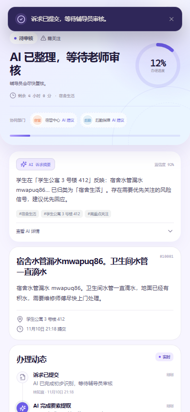
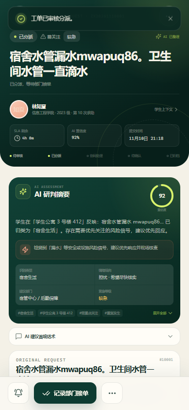
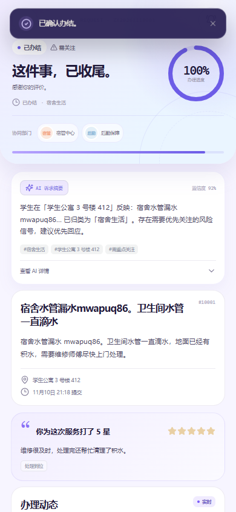
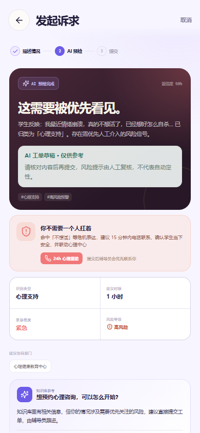

# Day 5 第一次集成 E2E 报告

> 执行人：D  
> 执行时间：2026-11-10 21:18（Asia/Shanghai）  
> 测试分支：本地 `test/day5-integration`（A 的 `feat/a-v1-fullchain` + C 的教师端分支，仅本地合并，未推送）

## 结论

**主应用的学生→辅导员完整主链路已跑通，但“团队第一次集成完成”还不能成立。**

- 主链路：8/8 通过，全程通过页面操作，没有手工改数据。
- 接口冒烟：5/5 通过，确认 `health`、学生/辅导员登录、工单列表与分页字段。
- 关键风险检查：P0 全部通过；P1 发现 1 个重复提交缺陷。
- 项目级 P0 仍有 2 个：A 的代码没有合入 `main`；C 的教师端仍是独立 Mock 项目，未接入真实后端。

## 主链路结果

| 步骤 | 结果 | 证据 |
| --- | --- | --- |
| 学生登录 | 已通 | `stu-lin`，角色 `student` |
| 学生提交工单 | 已通 | 新工单 `pending_review`，归属当前学生 |
| 辅导员登录并打开工单 | 已通 | 工单详情正常加载 |
| 审核并分派 | 已通 | 状态变为 `assigned`，分派至宿管中心、后勤保障 |
| 记录部门接单 | 已通 | 状态变为 `processing` |
| 录入处置结果 | 已通 | 状态变为 `awaiting_confirm` |
| 学生确认并评价 | 已通 | 状态变为 `completed`，5 星与评价内容已保存 |
| 390px 移动端 | 已通 | `scrollWidth=390`，无横向溢出 |

关键截图：







## 关键风险检查

| 检查 | 结果 | 证据 |
| --- | --- | --- |
| 无 Token 访问接口 | 已通 | HTTP 401，`code=40101`，`data=null` |
| 未登录访问受保护页面 | 已通 | 自动跳转 `/login` |
| 学生调用辅导员接口 | 已通 | HTTP 403，`code=40301` |
| 无模型 Key 的 AI 兜底 | 已通 | `engine=local-rules` |
| 高风险强制转人工工单 | 已通 | 显示高风险、不可自助关闭、可提交工单 |
| 360px 学生端 | 已通 | 首页、提交页、列表页均无横向溢出 |
| 重复提交拦截 | **未通过（P1）** | 相同内容第二次提交仍返回 HTTP 201，生成新工单 |



## P0 阻塞

### P0-1：A 的修复没有合入 `main`

- 远端 `main` 仍是 `81fd051`，`feat/a-v1-fullchain` 提交 `5cf1104` 尚未合并。
- GitHub 上没有 A 的 PR；D 无法替 A 评审或合并。
- 本次接口冒烟和 E2E 是在 A 分支的本地集成预演上通过，**不能写成 `main` 已通过**。
- 处理人：A。要求：发起 PR、评审、合并到 `main`，然后通知 D 复跑。

### P0-2：C 的教师端没有接入主应用

- C 的交付位于独立目录 `teacher-ui-v1/`，README 明确写明尚未接入仓库根目录后端，也没有替换原辅导员页面。
- 默认启用 MSW Mock（`VITE_USE_MOCK=true`），演示数据不等于真实联调。
- 契约不兼容：教师端请求 `/api/auth/me`、`/api/counselor/tickets`、`POST /api/counselor/tickets/:id/review|assign`；当前后端对应实际为 `/api/me`、`/api/tickets`、`PATCH /api/tickets/:id/review`，不存在 `/assign`。
- 对真实后端实测上述三个路径均返回 HTTP 404。
- 处理人：A/B/C。要求先冻结接口契约，再把教师页面并入主应用；不能用 Mock 结果作为第一次集成通过证据。

## P1 缺陷

### P1-1：重复提交未拦截

- 同一学生、同一描述、同一地点连续提交两次，均返回 HTTP 201 并创建两条工单。
- 建议由后端增加幂等或短时间重复检测：同一 `studentId` + 规范化描述 + 未办结工单，建议返回 `409` 并提示“请勿重复提交”。
- 负责人：A。

### P1-2：缺少第二个学生测试账号

- 种子数据只有 `stu-lin` 一个学生账号，无法自动验证“学生 A 访问学生 B 工单”的越权场景。
- 建议 B/C 或 A 补固定学生 B 账号与工单，之后补跑 E2E-06。

## 复现方式

```powershell
$env:VITE_USE_MOCK = 'false'
npm run seed
npm run dev
```

另开终端：

```powershell
npm run e2e
npm run e2e:critical
```

> 注意：必须在含 A 的 envelope 修复的代码上运行；直接在当前 `main` 上运行会因接口格式不符失败。
