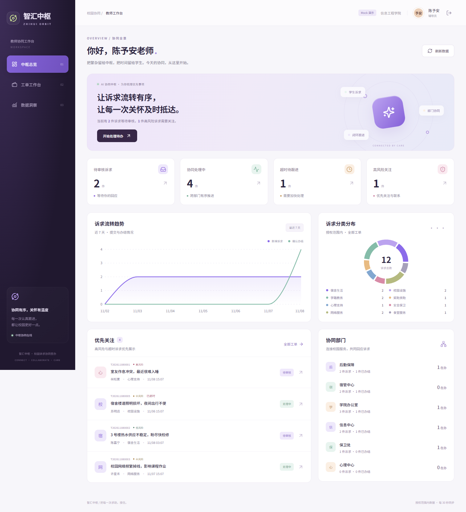

# 教师端UI第一版

本目录是智汇中枢教师端 UI 的独立交付版本，包含桌面工作台与手机响应式布局，默认使用 Mock。它尚未接入仓库根目录的后端，也没有替换原有辅导员页面。

仓库现有实现使用 `id`、`risk`、小写状态和 `/api/tickets`；本版按用户确认采用修订 PDF 的 `ticketId`、`riskLevel`、大写状态和 `/api/counselor/tickets`。接入前请先统一接口契约，具体差异见 `docs/接口补充与交接.md`。

从仓库根目录运行：

```powershell
cd teacher-ui-v1
npm ci
npm run dev
```

也可以在本目录双击 `start.cmd`。本版与根目录应用默认都使用 5180 端口，请一次只启动一个。切换应用前先停止另一个服务。自动化测试默认使用 Microsoft Edge，需要本机安装。



依据《技术分工.md》C 部分实现，按用户确认以《智汇中枢》前后端衔接约定_v1_修订优化版.pdf 优先。React 18 + TypeScript + Vite；仅教师/辅导员端，本地源码交付。

## 启动

Windows 推荐双击 `start.cmd`：它会检查依赖，在后台启动服务，确认就绪后自动打开网页。关闭启动窗口或浏览器不会停止服务；重复点击会复用已启动的服务。使用 `stop.cmd` 停止本项目的后台服务，重启电脑后需要再次运行 `start.cmd`。启动失败时窗口会保留错误信息，日志位于 `.runtime/`。

也可以在终端手动启动（此方式需保持终端运行）：

```powershell
npm install
npm run dev
```

打开 http://127.0.0.1:5180 。开发环境默认启用 MSW，可在登录页点击“一键体验教师端”。模拟账号 `counselor01`，密码 `demo123`，仅存在于 Mock，不是真实身份认证。

```powershell
npm run build
npm run preview
npm test
```

生产构建默认禁用 Mock，必须接入后端后使用；预览生产产物不会自动拥有演示登录。测试使用本机 Edge（配置见 playwright.config.ts）。首次安装项目已提供 public/mockServiceWorker.js，无需额外生成。

## 已实现

- 中枢首页：API 聚合统计、7 天趋势、分类分布、优先关注、部门协同。
- 工单台：状态组合、风险、超时、搜索、分页；筛选同步 URL，可刷新、分享、前进后退。
- 详情：原文、AI 摘要与风险理由、承办部门、SLA、附件 URL、流转记录、父子关联、内部备注。
- 操作：审核通过/退回草稿、单部门分派与经办人、SLA 预览、重新分派、2–5 子项拆分、催办、备注、提醒学生确认、合规状态归档。
- 洞察：趋势、分类、风险分层、部门效率、打印样式；图表提示和文本替代。
- 通用：加载/空/错误/禁用态、15 秒超时、401 登出、409 刷新且保留表单、重复提交拦截、30 秒可见页轮询、手机适配、键盘弹窗焦点约束、减少动效偏好。

PDF 优先所产生的范围变化：**不提供辅导员代录部门接单/反馈按钮，不把多部门数组提交给单部门分派接口，不实现学生评价或完整部门端。** 部门反馈在详情只读显示。只有后端提供相应权限才显示操作按钮。

## 接入真实后端

1. 请 A/B/D 先审阅 [接口补充与交接](docs/接口补充与交接.md)，确认补充字段和路径；PDF 缺少的定义尚未得到团队会签，不能声称已经真实联调。
2. 前后端共用 `src/types.ts`；前端请求统一在 `src/lib/api.ts`。不要在页面硬编码统计或将 Mock 数据作为生产兜底。
3. 新建不提交的 `.env.local`：
   ```env
   VITE_USE_MOCK=false
   VITE_API_BASE_URL=/api
   ```
4. 后端运行于 8787，Vite 5180 将 `/api` 代理过去；地址不同修改 vite.config.ts 的代理目标。重启开发服务，清除演示 token 后使用真实账号登录。
5. 生产同源托管，反向代理 `/api` 到后端；所有非静态、非 API 的路由回退 `index.html`，支持详情深链刷新。Mock 只在 DEV 且开关为 true 时启动。
6. 与学生端共用 `zhihui_token` 与统一登录/路由时，由 A/B 将当前入口壳并入主应用，保留 `src/pages/counselor/*`。当前 `App.tsx`、登录页面、共享类型、API 客户端、构建配置是无源码阶段搭建的集成脚手架，不应直接覆盖队友实现。

## 演示数据

MSW 拦截同源 `/api/*`；数据存储于浏览器 `zhihui_mock_v1_pdf`，刷新不丢失。12 条示例覆盖待审核、已分派、处理中、驳回、待确认、已确认和归档，包含高风险与超时；拆分后父子工单均可查看。重置时在浏览器控制台运行 `localStorage.removeItem('zhihui_mock_v1_pdf'); location.reload()`。这只删除演示工单，不影响真实后端。

图表和列表通过相同 Mock 数据集聚合，不固定写死统计值。Mock 是单浏览器演示，不具备真实并发、消息投递、数据库持久化或跨设备同步能力。提醒、催办生成模拟日志，真正通知需 A 后端负责。

## 目录与衔接

| 路径 | 职责 / 合并建议 |
| --- | --- |
| src/pages/counselor/ | C 页面与内部组件 |
| src/styles-counselor.css | 当前工作台样式；合并前与 B 的令牌、全局样式协调 |
| src/types.ts | PDF 基线及明确标注的补充字段；由 A 接管 |
| src/lib/api.ts | 统一 envelope、鉴权、错误、接口方法；交 A/B 接管 |
| src/mocks/browser.ts | MSW 演示实现、数据与校验；交 D 接管 |
| docs/接口补充与交接.md | 原文冲突裁决、尚需确认的缺失定义、验收责任 |
| docs/openapi.json | 与本实现一致的候选机器可读契约；尚非团队冻结版本 |
| tests/ | Playwright 交互与响应式回归 |

请勿将此独立项目覆盖合并到团队仓库根目录。先由 A/B 合并路由与公共层，再由 C 合并教师页面，D 合并 Mock 与测试。

网页地址为 http://127.0.0.1:5180，打开后点击“一键体验教师端”。仅打开网址不会自动启动本机服务器。完整验收证据见 [C 部分交付与验证](docs/C部分交付与验证.md)。
